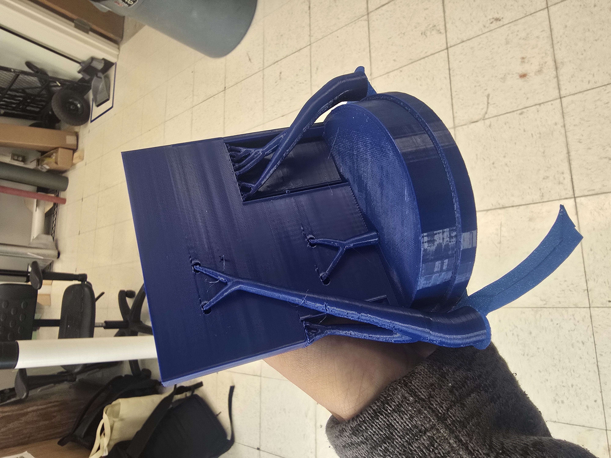
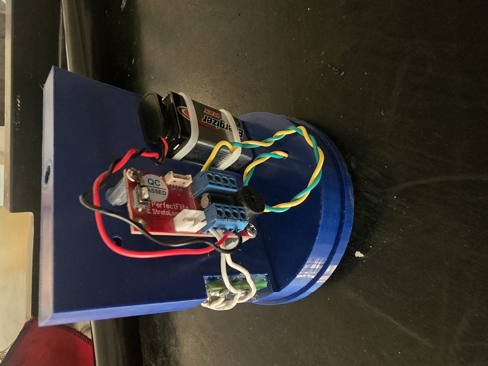
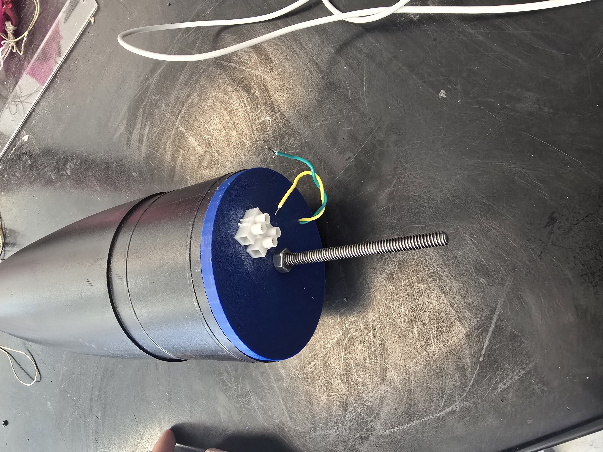

# Avionics Integration

## Overview

The rocket incorporated a custom 3D-printed avionics bay designed to house the onboard flight electronics within the plastic nose cone.
The enclosure accommodated a StratoLogger flight computer, a 9V battery, and a screw switch. Its removable design allowed access to the electronics following flight for data retrieval.

## 1. Avionics Bay Design

A custom enclosure was 3D-printed to accommodate the onboard electronics.

The enclosure featured a central opening to accommodate the mounting rod extending from the nose cone. The bay was designed to be removable rather than permanently bonded to the nose cone.

## 2. Electronic Components

| Component | Purpose |
|---|---|
| StratoLogger | Onboard flight instrumentation and data recording |
| 9V Battery | Power source |
| Screw Switch | Power switching |

## 3. Component Integration

The StratoLogger was mechanically secured within the enclosure using a mounting screw.

The 9V battery was secured using a zip tie, while the screw switch was incorporated into the electronics assembly.

## 4. Removable Avionics Assembly

The avionics bay was designed for removal after flight, providing access to the onboard electronics and allowing recorded flight data to be retrieved from the StratoLogger.

## 5. Avionics Gallery
<table>
  <tr>
    <td align="center">
      
    </td>
    <td align="center">
      
    </td>
    <td align="center">
      
    </td>
  </tr>
</table>