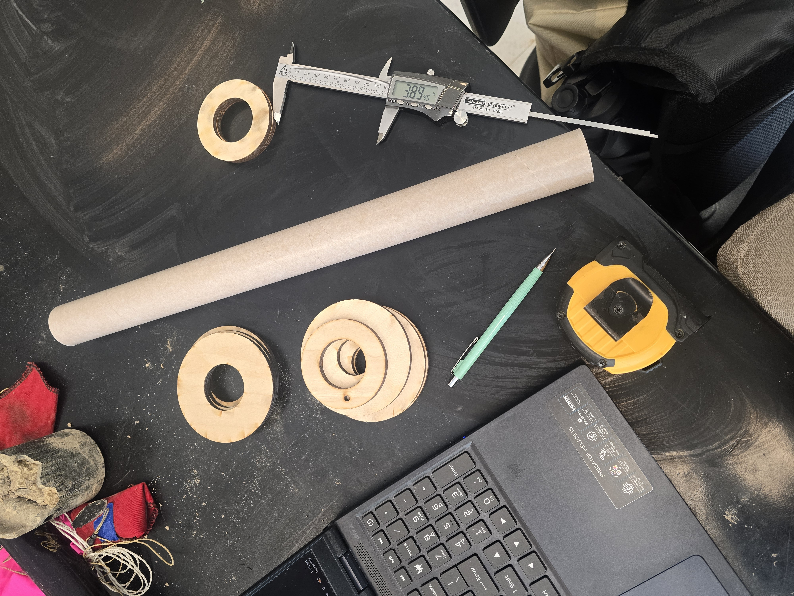
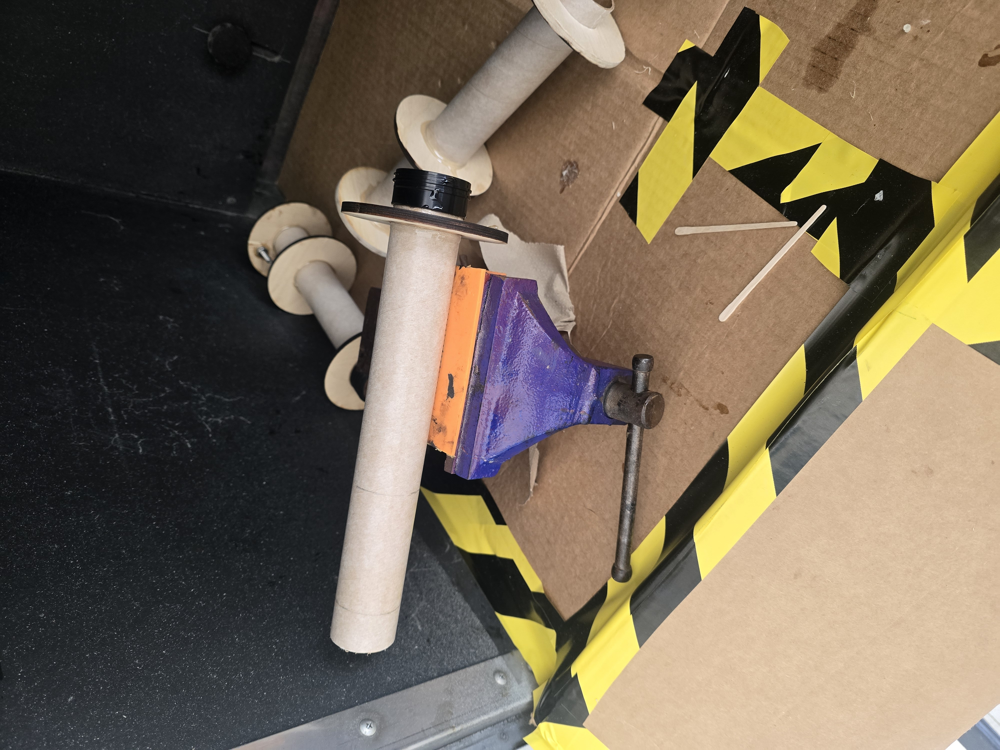
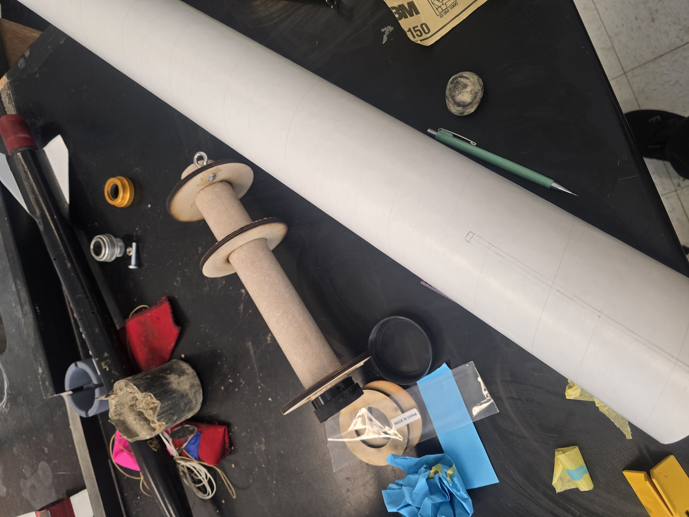
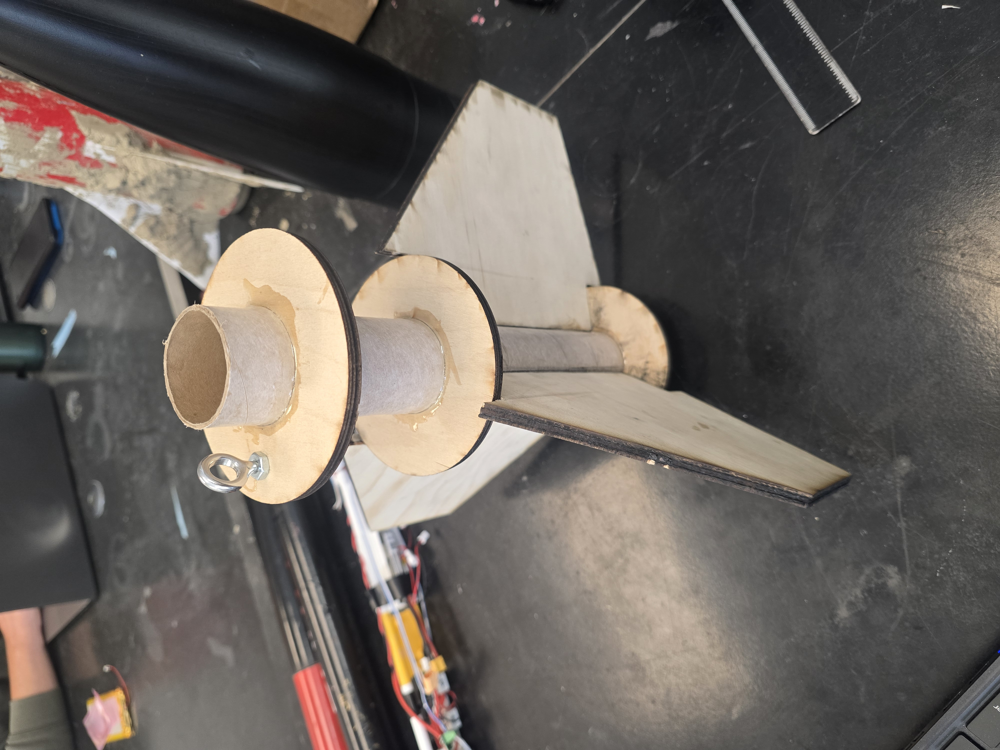
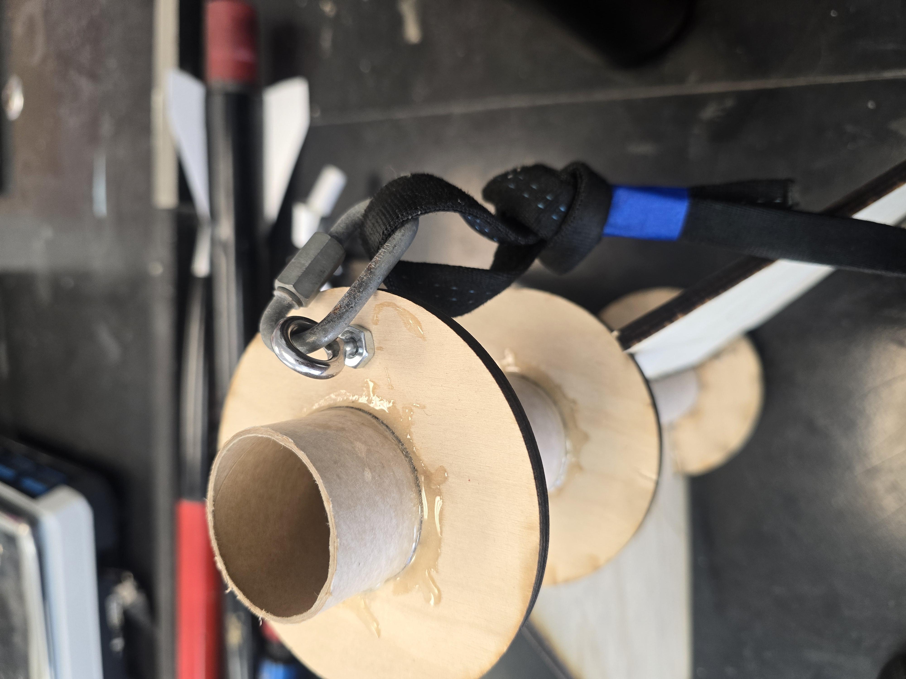

# Fabrication & Structural Construction

## Overview

The rocket was constructed using a combination of cardboard, plywood, and plastic components. Structural elements were manufactured using laser cutting and assembled through epoxy bonding.

## 1. Airframe & Nose Cone

The primary airframe consisted of a cardboard body tube paired with a plastic nose cone.

The nose cone incorporated an internal mounting rod that accommodated the custom 3D-printed avionics bay.

## 2. Fin Construction

The rocket utilized a three-fin configuration arranged symmetrically around the airframe.

The fins were manufactured from laser-cut plywood and featured internal fin tabs extending toward the motor mount assembly.

## 3. Motor Mount Assembly

The motor mount consisted of a cardboard motor tube supported by three plywood centering rings.

The fin tabs were positioned between two of the centering rings as part of the structural assembly.

## 4. Structural Assembly

The structural components were integrated using epoxy bonding. The fin and motor mount assemblies were incorporated into the cardboard airframe to form the completed rocket structure.

## 5. Construction Gallery

<table>
  <tr>
    <td align="center">
      
    </td>
    <td align="center">
      
    </td>
    <td align="center">
      
    </td>
    <td align="center">
      
    </td>
    <td align="center">
      
    </td>
  </tr>
</table>