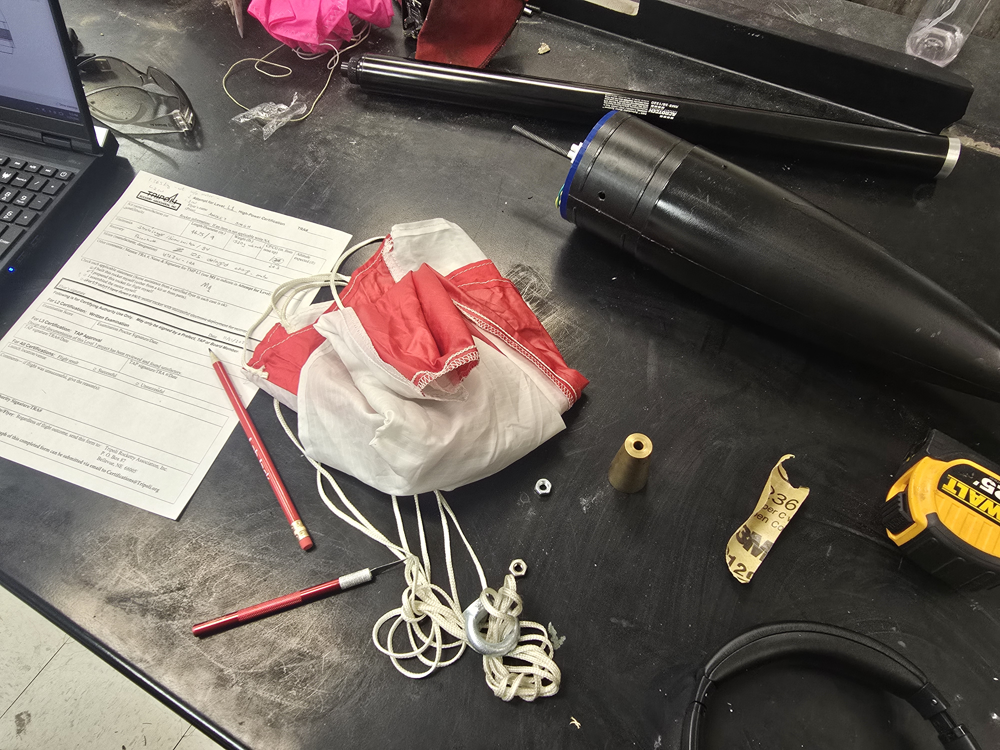
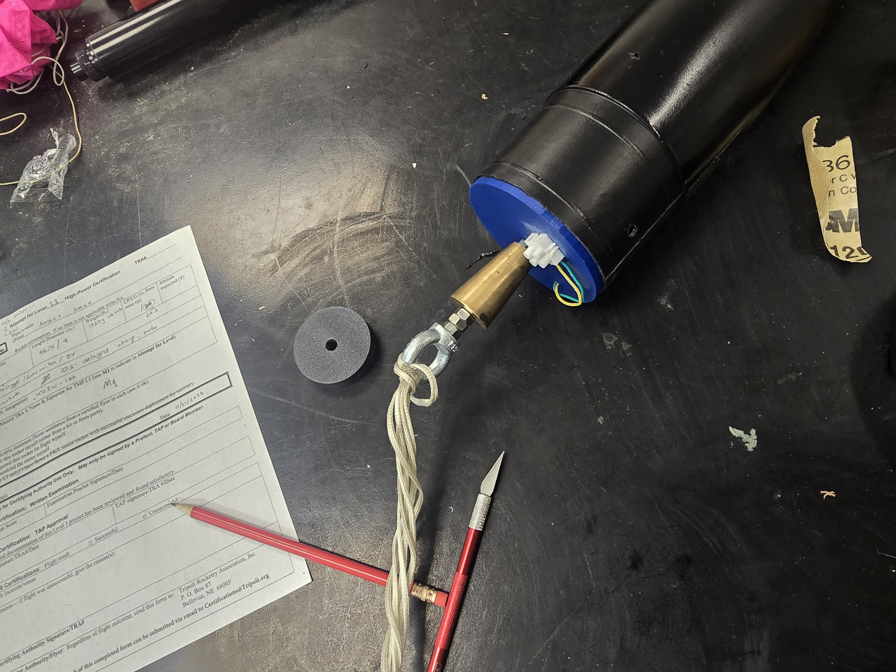
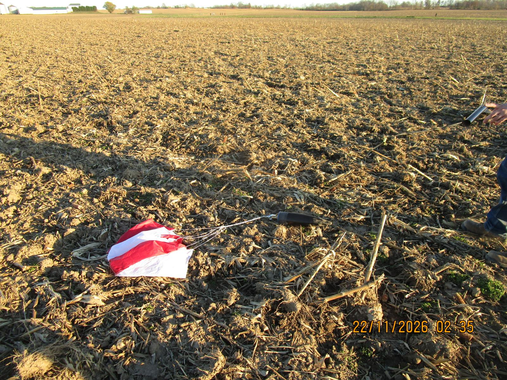

# Recovery System

## Overview

The rocket incorporated a parachute-based recovery system designed to facilitate recovery of the airframe following flight.

The recovery assembly utilized a shock cord connecting the nose cone and main body tube, with the parachute connected to the nose cone assembly.

## 1. Nose Cone Attachment

A threaded attachment point was installed into the internal rod extending from the nose cone.

The attachment point provided a loop for connecting the recovery components.

## 2. Parachute Integration

The parachute was connected to the nose cone assembly using a carabiner attached to the loop on the nose cone's mounting hardware.

This provided a detachable connection between the parachute and nose cone.

## 3. Shock Cord

A shock cord connected the nose cone and main body tube, maintaining a physical connection between the two sections during recovery.

## 4. Recovery Gallery

<table>
  <tr>
    <td align="center">
      
    </td>
    <td align="center">
      
    </td>
    <td align="center">
      
    </td>
  </tr>
</table>